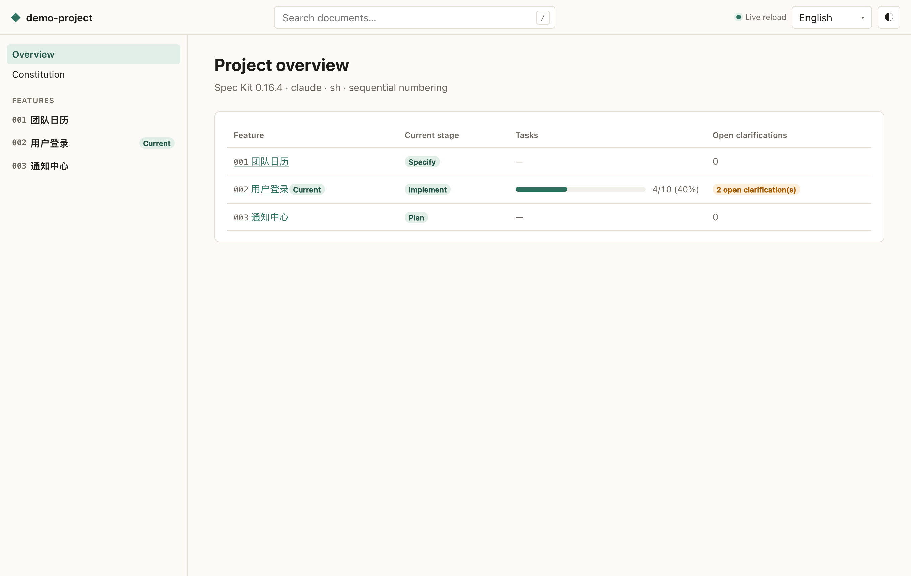
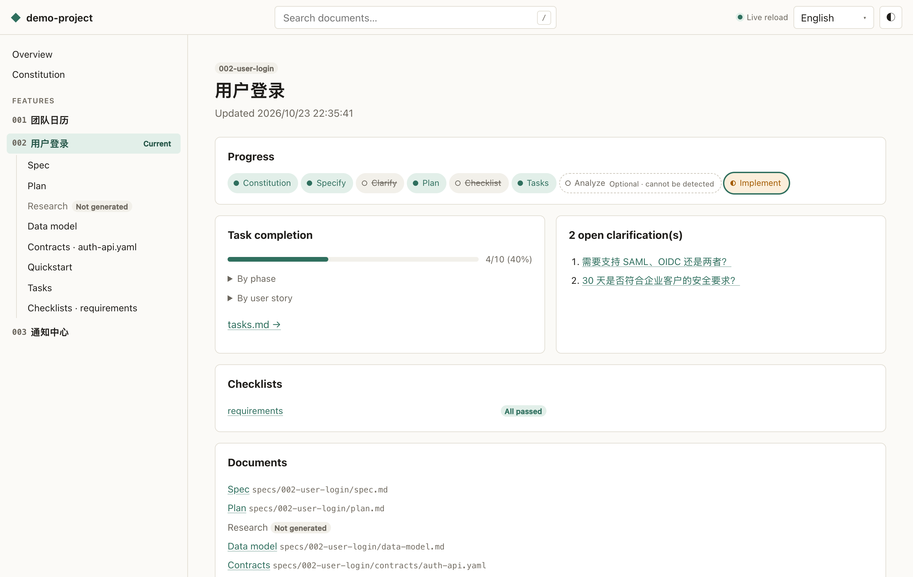
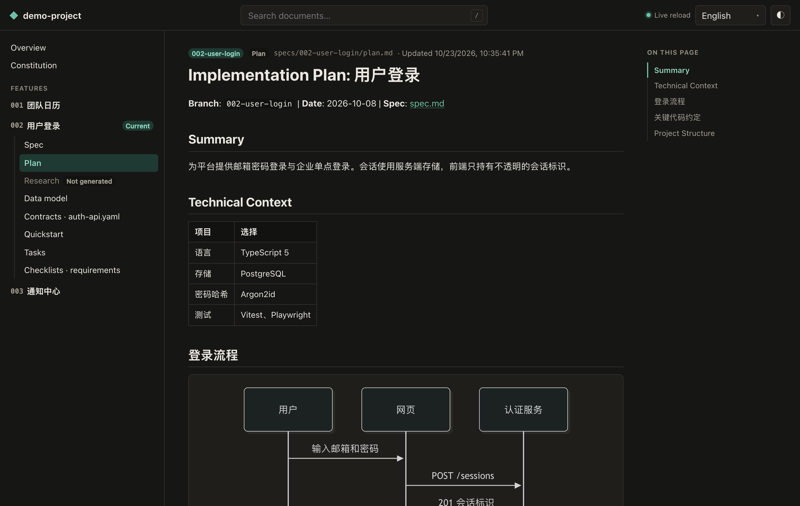
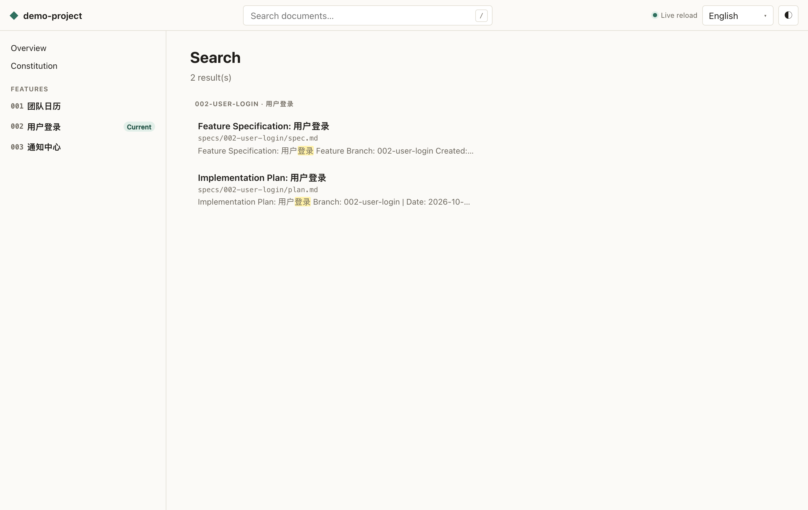

# Spec Kit Web

**English** · [简体中文](./README.zh-CN.md)

Browse, publish and initialize [GitHub Spec Kit](https://github.com/github/spec-kit) projects in the browser.

- **Local viewer** — one command opens your constitution, specs, plans, tasks and checklists as a readable site that reloads as files change.
- **Progress at a glance** — the stage of every feature (constitution → specify → clarify → plan → checklist → tasks → analyze → implement), task completion by phase and user story, checklist results and open `[NEEDS CLARIFICATION]` markers.
- **Static publishing** — export the documents to a self-contained static site (works under any sub-path, e.g. GitHub Pages).
- **Search & cross references** — full-text search (Chinese included) and clickable `FR-001` / `SC-001` / `T001` / `CHK001` ids.
- **Project initialization** — a CLI prompt or a web wizard that runs the official `specify init`, previews every file it will write and rolls back on failure.
- Read-only by design, light/dark themes, English and 简体中文.

[Live demo](https://speckit-web.github.io/speckit-web/) · [Screenshots](#screenshots)

## Quick start

Requires **Node.js 22+**.

```bash
# Browse a Spec Kit project (the current directory by default)
npx speckit-web

# …or any other directory
npx speckit-web path/to/project
```

The viewer opens at `http://localhost:5178/` (the next free port is used when it is busy). Press `Ctrl+C` to stop.

Want to try it without a project of your own? Clone this repository and run:

```bash
pnpm install && pnpm build
node dist/cli.js examples/demo-project
```

## Commands

| Command | What it does |
|---|---|
| `speckit-web [dir]` | Start the local viewer (`--port <n>`, `--no-open`) |
| `speckit-web build [dir]` | Build a static site (`--out <path>` default `<dir>/speckit-site`, `--title`, `--json`) |
| `speckit-web init [name]` | Initialize a Spec Kit project (`--here`, `--integration`, `--script sh\|ps\|py`, `--numbering sequential\|timestamp`, `--yes`, `--force`, `--dry-run`, `--open`, `--json`) |

All commands accept `--lang zh-CN|en`. Exit codes: `0` ok, `1` error, `2` bad arguments, `3` not a Spec Kit project, `4` `specify`/`uvx` missing, `130` cancelled. Full details: [contracts/cli.md](./specs/001-speckit-web-scaffold/contracts/cli.md).

### Initializing a project

`speckit-web init` delegates to the official Spec Kit CLI, so the result is exactly what `specify init` produces. It needs either `specify` or `uvx` on your PATH:

```bash
# macOS / Linux
curl -LsSf https://astral.sh/uv/install.sh | sh
# Windows
powershell -ExecutionPolicy ByPass -c "irm https://astral.sh/uv/install.ps1 | iex"

uv tool install specify-cli --from git+https://github.com/github/spec-kit.git
```

The project is generated in a temporary directory first; if the target is not empty you see the list of files that would be created or overwritten and must confirm. When you open the viewer on a directory without `.specify/`, the page offers the same flow as a wizard.

## Publish to GitHub Pages

1. Copy [`examples/github-pages.yml`](./examples/github-pages.yml) to `.github/workflows/speckit-pages.yml` in your project.
2. In **Settings → Pages**, set **Source** to **GitHub Actions**.
3. Push. Every change under `specs/` or `.specify/memory/` republishes the site.

The site only contains the constitution and documents under `specs/` — never source code, `.git/` or `.env` files.

## Security model

- The local server listens on `127.0.0.1` only and rejects requests whose `Host` is not localhost (DNS-rebinding protection).
- Documents are read from a whitelist built at scan time (constitution + `specs/**` Markdown/YAML/JSON/GraphQL/Proto/text); paths escaping the project through `..` or symlinks are ignored.
- Rendered HTML is sanitized. Browsing never writes to the project; the only write is the init wizard, which needs a per-process token and explicit confirmation.

See [SECURITY.md](./SECURITY.md) to report a vulnerability.

## Screenshots

| Overview | Feature progress |
|---|---|
|  |  |
| **Document (dark)** | **Search** |
|  |  |

## Use this repository as a template

Click **Use this template** (or fork) on GitHub to get a complete, runnable copy: the viewer, the demo project, tests and CI workflows.

## Contributing

Contributions are welcome — please read [CONTRIBUTING.md](./CONTRIBUTING.md) and our [Code of Conduct](./CODE_OF_CONDUCT.md). This project is itself built with Spec Kit; the specification lives in [`specs/001-speckit-web-scaffold/`](./specs/001-speckit-web-scaffold/spec.md).

## License

[MIT](./LICENSE)
