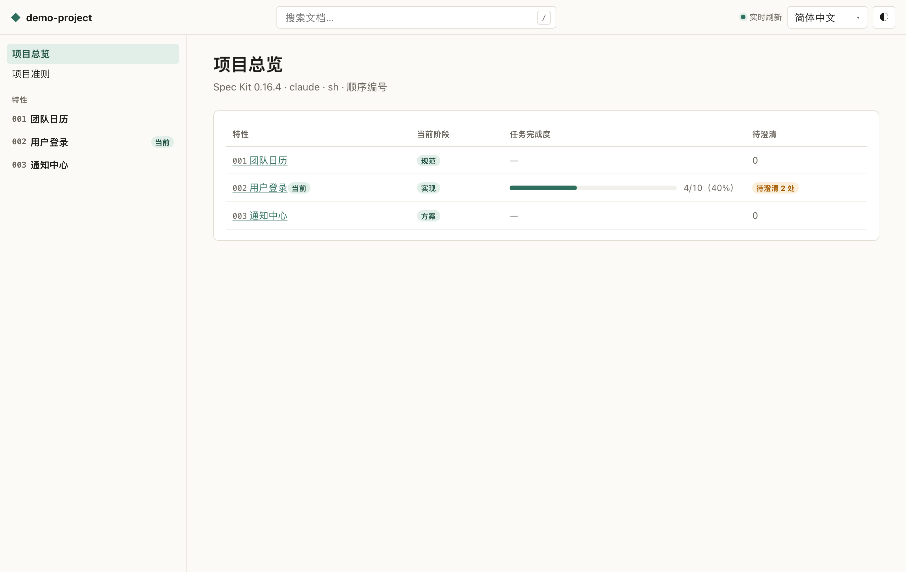
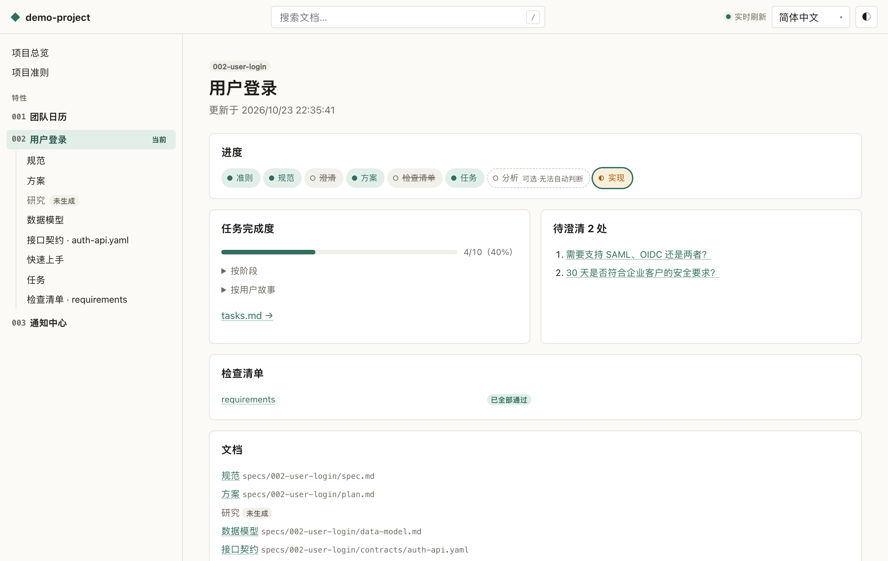
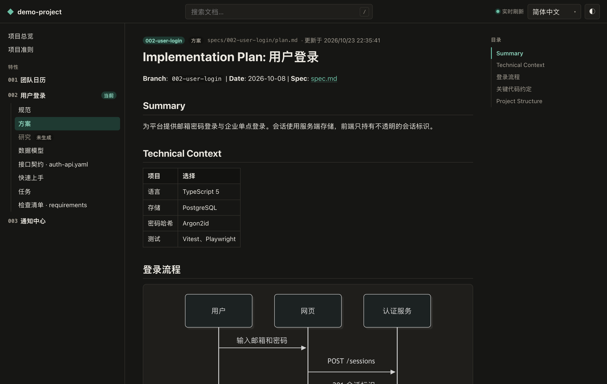
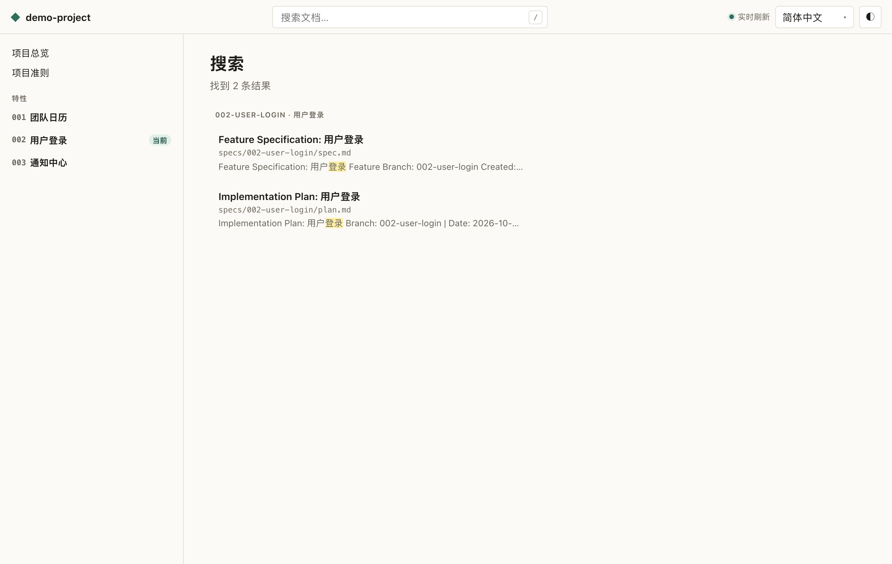

# Spec Kit Web

[English](./README.md) · **简体中文**

在浏览器中浏览、发布和初始化 [GitHub Spec Kit](https://github.com/github/spec-kit) 项目。

- **本地查看**：一条命令把准则、规范、方案、任务和检查清单变成排版良好的网页，文件一改页面就刷新。
- **进度一目了然**：每个特性所处的阶段（准则 → 规范 → 澄清 → 方案 → 检查清单 → 任务 → 分析 → 实现）、按阶段和用户故事统计的任务完成度、检查清单结果，以及剩余的 `[NEEDS CLARIFICATION]` 标记。
- **静态发布**：把文档导出为自包含的静态网站，可部署在任意子路径下（例如 GitHub Pages）。
- **搜索与交叉跳转**：支持中文的全文搜索；`FR-001`、`SC-001`、`T001`、`CHK001` 等编号可点击跳转。
- **项目初始化**：命令行问答或网页向导，调用官方 `specify init`，写入前列出每个文件，失败自动回滚。
- 浏览全程只读，支持浅色/深色主题和中英文界面。

[在线演示](https://speckit-web.github.io/speckit-web/) · [截图](#截图)

## 快速开始

需要 **Node.js 22+**。

```bash
# 查看 Spec Kit 项目（默认当前目录）
npx speckit-web

# 或指定目录
npx speckit-web path/to/project
```

查看器默认打开 `http://localhost:5178/`（端口被占用时自动换下一个），按 `Ctrl+C` 停止。

手头没有项目？克隆本仓库后运行：

```bash
pnpm install && pnpm build
node dist/cli.js examples/demo-project
```

## 命令

| 命令 | 作用 |
|---|---|
| `speckit-web [dir]` | 启动本地查看器（`--port <n>`、`--no-open`） |
| `speckit-web build [dir]` | 构建静态站点（`--out <path>` 默认 `<dir>/speckit-site`，`--title`，`--json`） |
| `speckit-web init [name]` | 初始化 Spec Kit 项目（`--here`、`--integration`、`--script sh\|ps\|py`、`--numbering sequential\|timestamp`、`--yes`、`--force`、`--dry-run`、`--open`、`--json`） |

所有命令都支持 `--lang zh-CN|en`。退出码：`0` 成功，`1` 运行错误，`2` 参数错误，`3` 不是 Spec Kit 项目，`4` 缺少 `specify`/`uvx`，`130` 已取消。详见 [contracts/cli.md](./specs/001-speckit-web-scaffold/contracts/cli.md)。

### 初始化项目

`speckit-web init` 调用官方 Spec Kit 命令行，生成结果与 `specify init` 完全一致。需要 PATH 中有 `specify` 或 `uvx`：

```bash
# macOS / Linux
curl -LsSf https://astral.sh/uv/install.sh | sh
# Windows
powershell -ExecutionPolicy ByPass -c "irm https://astral.sh/uv/install.ps1 | iex"

uv tool install specify-cli --from git+https://github.com/github/spec-kit.git
```

项目会先在临时目录中生成；目标目录不是空的时，会列出将新增和覆盖的文件，确认后才写入。在没有 `.specify/` 的目录上打开查看器时，页面会提供同样流程的初始化向导。

## 发布到 GitHub Pages

1. 把 [`examples/github-pages.yml`](./examples/github-pages.yml) 复制到你项目的 `.github/workflows/speckit-pages.yml`。
2. 在 **Settings → Pages** 中把 **Source** 设为 **GitHub Actions**。
3. 推送代码。之后 `specs/` 或 `.specify/memory/` 有变化就会自动重新发布。

站点只包含准则和 `specs/` 下的文档，不会包含源代码、`.git/` 或 `.env` 文件。

## 安全模型

- 本地服务只监听 `127.0.0.1`，`Host` 不是 localhost 的请求一律拒绝（防 DNS 重绑定）。
- 只能读取扫描时登记的白名单文档（准则 + `specs/**` 下的 Markdown/YAML/JSON/GraphQL/Proto/文本）；通过 `..` 或符号链接指向项目外的路径会被忽略。
- 渲染结果经过净化。浏览不会写入项目；唯一的写操作是初始化向导，需要进程级令牌并经用户明确确认。

发现安全问题请按 [SECURITY.md](./SECURITY.md) 报告。

## 截图

| 项目总览 | 特性进度 |
|---|---|
|  |  |
| **文档（深色）** | **搜索** |
|  |  |

## 以本仓库为模板

在 GitHub 上点击 **Use this template**（或 Fork），即可得到包含查看器、示例项目、测试和 CI 的完整可运行副本。

## 参与贡献

欢迎贡献，请先阅读 [CONTRIBUTING.md](./CONTRIBUTING.md) 和 [行为准则](./CODE_OF_CONDUCT.md)。本项目本身也用 Spec Kit 开发，规范见 [`specs/001-speckit-web-scaffold/`](./specs/001-speckit-web-scaffold/spec.md)。

## 许可证

[MIT](./LICENSE)
