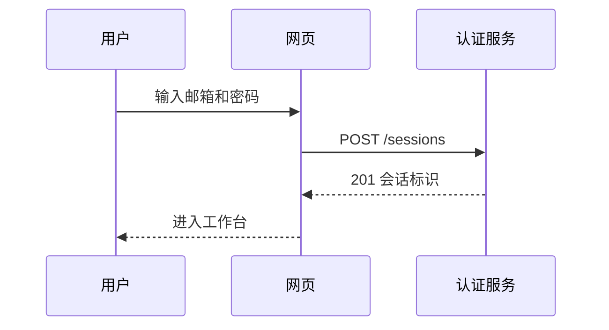

# Implementation Plan: 用户登录

**Branch**: `002-user-login` | **Date**: 2026-10-08 | **Spec**: [spec.md](./spec.md)

## Summary

为平台提供邮箱密码登录与企业单点登录。会话使用服务端存储，前端只持有不透明的会话标识。

## Technical Context

| 项目 | 选择 |
|---|---|
| 语言 | TypeScript 5 |
| 存储 | PostgreSQL |
| 密码哈希 | Argon2id |
| 测试 | Vitest、Playwright |

## 登录流程



## 关键代码约定

```ts
export interface Session {
  id: string;
  userId: string;
  expiresAt: Date;
}
```

## Project Structure

数据模型见 [data-model.md](./data-model.md)，接口见 [contracts/auth-api.yaml](./contracts/auth-api.yaml)。
